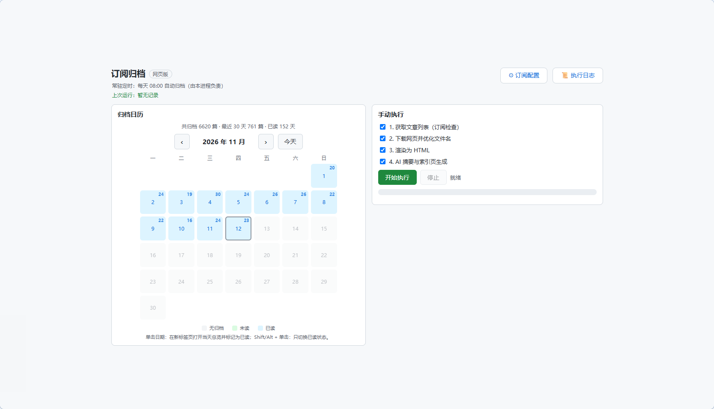
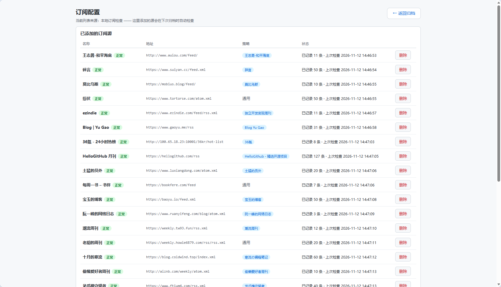

<p align="center">
  <h1 align="center">📥 订阅归档</h1>
  <p align="center">检查订阅更新 → 下载网页 → 渲染干净 HTML → AI 摘要</p>
</p>

<p align="center">
  
  
  
</p>

## 📖 背景

RSS 阅读适合快速浏览，但文章链接会失效、网站会改版、内容会被删除。本项目定期检查订阅源，把新文章**完整归档到本地**：下载网页、渲染成干净且适合手机阅读的 HTML、图片存到本地，并用 AI 生成摘要。

没有 RSS 的站点（微博、知乎、B 站等）可先用 [RSSHub](https://docs.rsshub.app/) 转成订阅地址，再加进订阅列表。

为什么归档成本地 HTML：

- **永久保存**：本地副本不依赖任何平台，不担心下架或反爬
- **随处可读**：干净 HTML + 本地图片，任意浏览器打开；整个 `result/` 同步到 NAS 就能多端浏览
- **每日索引**：每天生成按来源分组的索引页

## ✨ 特性

- **订阅检查**：抓取 RSS/Atom，按 guid 去重，支持 ETag / Last-Modified 条件请求
- **订阅管理页**：网页版可查看、添加、删除订阅源，粘贴任意网址自动查找可用 feed，并显示每个源命中的解析策略
- **智能识别**：策略模式识别 22 种来源（少数派、36氪、阮一峰等），按来源提取正文
- **干净输出**：剥离脚本与广告，套响应式模板，图片本地化到 `assets/`
- **AI 摘要**：DeepSeek API 生成摘要，注入文章页
- **网页版界面**：纯标准库本地 HTTP 服务，含归档日历、执行日志独立页面、进度与上次运行摘要

## 🖥 界面截图



## 🚀 使用

### 桌面小窗口

双击 `启动控制台.bat`，弹出只有两个按钮的小窗口：**打开 web 页面 / 退出服务**。归档操作都在网页版里完成。

- 用 `pythonw.exe` 启动，不留控制台窗口
- **关闭窗口不会退出**：收进系统托盘继续后台跑，每日定时照常生效；右键托盘可「打开主窗口 / 退出」
- 彻底退出用托盘右键「退出」或窗口里的「退出服务」

> 需要 Python 自带 `tkinter`；缺失时可用命令行方式运行 `src/webui.py`。

```bash
.venv/Scripts/pythonw.exe src/gui.py              # 等价于双击 启动控制台.bat
.venv/Scripts/python.exe  src/gui.py --port 9000   # 带控制台，便于排查
```

### 添加订阅源

两种方式：

1. 网页版右上角 **⚙ 订阅配置** → 粘贴地址 → 查找 → 添加（支持原生 RSS/Atom 地址、RSSHub 路由）
2. 直接编辑 `src/watch_feeds.json`（首次使用可从 `src/watch_feeds.example.json` 复制）：

```json
{
  "feeds": [
    { "name": "少数派", "url": "https://sspai.com/feed" }
  ]
}
```



> 首次检查某个源时只记基线，不会把历史文章一次性全部归档。

## 🔄 工作原理

一次归档分四步，串行执行；任何一步失败都不会中断其他源/文章，失败项会在日志和索引页里标注。

```
检查订阅更新 → 下载原始 HTML → 渲染干净 HTML → AI 摘要 + 索引页
    │              │                │                │
 watch_export   save_webpages    render_html       summarize
```

### 1. 检查订阅更新（watch_export）

- 读取 `src/watch_feeds.json` 的订阅列表，逐条发请求
- 带 `ETag` / `Last-Modified` 条件请求，源站返回 304 就直接跳过，几乎零流量
- 解析出条目的唯一 ID（优先源站的 `id`/`guid`，没有则用链接或标题+时间的哈希）
- 与本地数据库 `result/temp_data/watch.db` 比对，**没见过的才算新文章**
- 新条目写进数据库和当天的 `result/temp_data/「日期」.json`，供后续步骤使用
- 网络抖动会自动重试一次；单个源失败只影响该源

> 某个源第一次被检查时，现有条目全部记为基线，不当作更新——避免第一次就归档几百篇旧文。

### 2. 下载原始 HTML（save_webpages）

- 按当天 JSON 里的原文链接逐篇下载，存到 `result/temp_data/raw/<日期>/`
- 统一带浏览器 UA，部分站点补 Referer；下载失败记录原因并跳过
- 文件名统一成 `「来源」标题.html`，去掉非法字符、超长截断

### 3. 渲染干净 HTML（render_html）

- 按站点识别解析策略（内置 22 种，未命中则用通用策略）
- 剥离 `<script>` / `<style>` / `<iframe>`、`on*` 事件属性、`javascript:` 链接
- 套响应式模板，样式统一外链到 `result/style.css`（改一处，所有页面生效）
- 正文里的图片下载到同级 `assets/`，离线也能看
- 输出到 `result/<日期>/「来源」标题.html`

### 4. AI 摘要 + 索引页（summarize）

- 调用 DeepSeek API 为每篇生成摘要，注入文章页的摘要区块
- **断点续跑**：已有摘要的文章直接跳过，不重复消耗 token；加 `--force` 才全部重算
- 并发 10 篇，请求失败按指数退避重试
- 最后生成当天索引页 `result/<日期>/<日期>.html`：按来源分组，列出标题、原文链接与摘要；下载/渲染失败的条目就地标注，不会从索引里消失

### 产物结构

```
result/
├── style.css                     # 全站共享样式
├── read_state.json               # 阅读状态（日历用）
├── temp_data/
│   ├── watch.db                  # 已见条目（去重状态）
│   ├── 「日期」.json              # 当天的文章列表
│   └── raw/<日期>/               # 下载的原始 HTML（中间产物）
└── <日期>/
    ├── YYYY年MM月DD日.html        # 当天索引页
    ├── 「来源」标题.html           # 文章正文
    └── assets/                   # 文章图片
```

### 触发方式与幂等

- **手动**：网页版勾选步骤 → 开始执行
- **定时**：默认每天 08:00（`config.json` 的 `schedule`），到点时程序在运行才触发；启动时若已过点不会补跑
- **断点续跑**：同一天重跑会复用已下载的列表和已生成的摘要，只补失败或缺失的部分
- 当天列表 JSON 已存在时，步骤 1 会跳过抓取——想强制重抓，删掉该 JSON 或用 `--date` 指定其他日期
## 📄 许可证

[MIT](LICENSE)
